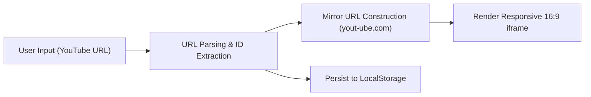

# Project Knowledge Base & Reasoning Notes: YouTube No-Ads

Comprehensive architectural notes, system specifications, and contextual findings compiled from repository inspection for subsequent reasoning and development.

---

## 1. Project Overview & Intent

- **Name**: `youtube-no-ads` (labeled as `youtube-no-app` in [package.json](file:///app/package.json#L2))
- **Live Deployment**: Hosted on Cloudflare Pages at [https://youtube-no-ads.pages.dev/](https://youtube-no-ads.pages.dev/)
- **Core Purpose**: A lightweight, client-side web application designed to allow users to watch YouTube videos without advertisements.
- **Operational Mechanism**: Converts user-provided YouTube URLs into mirror/proxy player URLs hosted at `https://yout-ube.com/watch?v={VIDEO_ID}` and displays them inside embedded `<iframe>` elements.



---

## 2. Technical Stack & Environment

| Component | Technology / Tool | Version / Details |
| :--- | :--- | :--- |
| **Frontend Core** | Vanilla HTML5, CSS3, JavaScript (ES2024 / ES Modules) | No external frontend framework; raw DOM manipulation |
| **Bundler & Server** | [Vite](file:///app/vite.config.js) | v7.3.5; MPA mode (`appType: 'mpa'`), base `./`, drops `console`/`debugger` in production |
| **Deployment / Edge** | [Cloudflare Pages / Wrangler](file:///app/wrangler.jsonc) | Wrangler v4.69.0; output directory `./dist` |
| **Linting** | [ESLint](file:///app/eslint.config.mjs) | Flat config (`eslint.config.mjs`), `@eslint/js` 9.34.0, globals for browser & service worker |
| **Testing** | [Vitest](file:///app/package.json#L23) | v4.1.5; currently no test files configured |
| **Dev Containers** | Docker & DevContainer | Based on `mcr.microsoft.com/devcontainers/javascript-node:24` with Antigravity CLI |
| **Cloud IDE** | Project IDX | Configured via [.idx/dev.nix](file:///app/.idx/dev.nix) using Node.js 24 and extensions |

---

## 3. Directory Layout & Key Files

```text
/app
├── .agents/
│   └── AGENTS.md               # User rules & guidelines for Antigravity Gemini
├── .devcontainer/              # Dev container configuration (Docker Compose backend)
├── .idx/
│   └── dev.nix                 # Project IDX environment configuration
├── dist/                       # Production build output (managed by Vite / Wrangler)
├── public/
│   ├── icons/                  # Maskable icons (192px, 512px) & device screenshots
│   ├── sw.js                   # Workbox CDN service worker (routing strategies)
│   └── javascript.svg, vite.svg
├── src/
│   └── main.js                 # Empty modular entry point (reserved for refactoring)
├── index.html                  # Main application: styles, DOM markup, and inline JavaScript logic
├── manifest.json.deprecated.txt# Deprecated manifest (renamed to disable standalone PWA)
├── package.json                # Dependencies, project metadata, and npm scripts
├── vite.config.js              # Vite bundler configuration
├── wrangler.jsonc              # Cloudflare Pages deployment configuration
├── eslint.config.mjs           # ESLint flat configuration
└── NOTES.md                    # Project notes & architecture guide (this file)
```

---

## 4. Key Architectural Findings & Design Decisions

### 4.1 URL Parsing Logic in [index.html](file:///app/index.html#L198-L218)
The inline `loadVideo(links)` function parses input lines as follows:
1. Filters out empty strings and links not starting with `https://`.
2. Normal YouTube watch URLs:
   - Condition: `link.startsWith('https://www.youtube.com/watch?v=')`
   - Extraction: `new URL(link).searchParams.get('v')`
3. Shortened share URLs:
   - Condition: `link.startsWith('https://youtu.be/')`
   - Extraction: `new URL(link).pathname.substring(1)`
4. Creates an `.iframe-wrapper` containing an `<iframe>` pointing to `https://yout-ube.com/watch?v=${path}` with attributes:
   - `referrerpolicy="no-referrer"`
   - `allow="autoplay; encrypted-media; picture-in-picture"`
   - `allowfullscreen="true"`

### 4.2 The PWA & Background Play Tradeoff
- **Discovery**: In commit `09e6a7a`, `manifest.json` was renamed to `manifest.json.deprecated.txt` and commented out in [index.html](file:///app/index.html#L9-L10).
- **Reasoning**: Standalone PWA mode on mobile devices (Android/iOS) suspends media playback when the app is backgrounded or screen locked. Operating as a standard web page in browser tabs allows mobile browsers to support background audio/video playback.
- **Service Worker**: [public/sw.js](file:///app/public/sw.js) remains in the codebase with Workbox caching strategies (`CacheFirst` for images, `NetworkFirst` for scripts, `StaleWhileRevalidate` for document pages), but registration in [index.html](file:///app/index.html) is currently omitted.

### 4.3 Separation of Concerns Status
- Currently, styles and runtime logic are housed directly in [index.html](file:///app/index.html).
- [src/main.js](file:///app/src/main.js) is linked via `<script type="module" src="src/main.js" async></script>` in [index.html](file:///app/index.html#L11), but `main.js` is currently 0 bytes.
- Guidelines in [.agents/AGENTS.md](file:///app/.agents/AGENTS.md#L47-L50) suggest separating JavaScript into [src/main.js](file:///app/src/main.js) and styles into a separate stylesheet when adding substantial features.

---

## 5. Current Edge Cases & Fragilities

> [!WARNING] URL Extraction Fragilities
> The current URL matcher uses exact prefix string matching (`startsWith`):
> 1. **Mobile URLs**: `https://m.youtube.com/watch?v=...` is rejected.
> 2. **Query parameters order**: A link like `https://www.youtube.com/watch?feature=shared&v=abc` fails because `v=` is not immediately following `watch?`.
> 3. **YouTube Shorts / Live**: `https://www.youtube.com/shorts/{id}` and `https://www.youtube.com/live/{id}` are not handled.
> 4. **Query parameters in share links**: `https://youtu.be/abc?si=xyz` results in `pathname.substring(1)` being `abc`, which works via `URL.pathname`, but if subpaths or trailing slashes exist, it may require sanitation.

> [!NOTE] Testing Suite Status
> Running `npm run test` (`vitest`) fails immediately with code 1 because Vitest detects zero test files in the project. Adding a test suite (e.g. for URL extraction and state persistence) will stabilize future refactoring.

> [!NOTE] Metadata Consistency
> `package.json` specifies `"name": "youtube-no-app"`, while `wrangler.jsonc` specifies `"name": "youtube-no-ads"`.

---

## 6. Development Scripts & Workflow Cheat Sheet

| Command | Action | Notes |
| :--- | :--- | :--- |
| `npm run dev` | Starts Vite local dev server | Default port `5173` |
| `npm run build` | Compiles static site to `dist/` | Drops console logs & debugger calls |
| `npm run preview` | Serves `./dist` locally | Runs on port `4173` |
| `npm run build-n-preview`| Builds and starts preview server | Convenient single command |
| `npm run lint` | Runs ESLint flat config | Checks all `.js`, `.mjs`, `.cjs` |
| `npm run test` | Runs Vitest in watch mode | Requires test files or `--passWithNoTests` |
| `npx wrangler pages dev` | Emulates Cloudflare Pages | Tests edge hosting environment locally |

---

## 7. Next-Step Recommendations for Future Tasks

1. **Extract Core Logic to [src/main.js](file:///app/src/main.js)**:
   - Modularize URL parsing and DOM rendering functions out of [index.html](file:///app/index.html).
2. **Robust URL Parsing Utility**:
   - Support `m.youtube.com`, `music.youtube.com`, YouTube Shorts (`/shorts/`), YouTube Live (`/live/`), and arbitrary query parameter ordering.
3. **Unit Tests Setup**:
   - Create `src/url-parser.test.js` or `tests/url.test.js` with Vitest to establish regression safety for all YouTube URL variants.
4. **Preserve PWA & Background Decisions**:
   - Maintain the intentional decision to avoid forcing standalone PWA mode so background playback remains functional on mobile devices.
