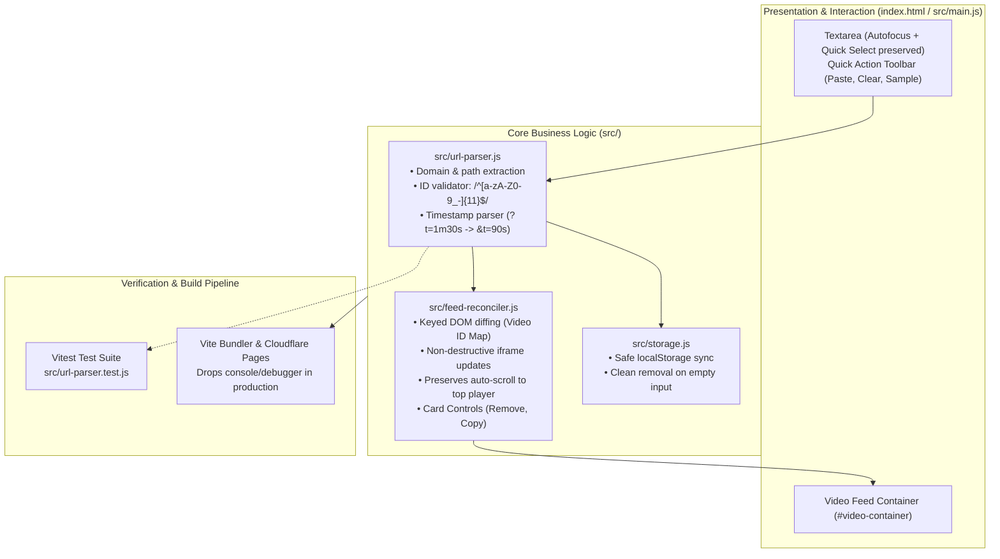

# YouTube No-Ads: Verified Technical Roadmap & Improvement Plan

This refined plan outlines verified architectural improvements, bug fixes, and feature additions for YouTube No-Ads. Every item reflects repository inspection, build pipeline validation, and user design constraints.

---

## 1. Verified Architecture & Core Design Decisions

> [!NOTE] Explicit User-Confirmed Intentional Behaviors
> - **Auto-Scroll to Player**: Automatically scrolling to the first player (`firstIframe.scrollIntoView(...)`) when videos load is **intended behavior** to immediately bring media into view upon input. Preserved.
> - **Autofocus & Quick-Select**: Automatically focusing the textarea on load and selecting existing text (`focus` -> `e.target.select()`) is **intended behavior** to facilitate immediate paste/overwrite workflows. Preserved.
> - **No Lazy Loading on Iframes**: Iframes should load eagerly without `loading="lazy"` constraints. Preserved.

---

## 2. Verified Codebase Audit & Defects to Resolve

| Defect / Weakness | Location | Impact | Severity |
| :--- | :--- | :--- | :--- |
| **Strict URL Matching Failure** | [index.html:206-214](file:///app/index.html#L206-L214) | Fails on `m.youtube.com`, `shorts/`, `live/`, `embed/`, non-https, timestamps, and when `v=` is not the first query parameter. | **High** |
| **Iframe Reload on Input (No Feed Preservation)** | [index.html:221-223](file:///app/index.html#L221-L223) | `innerHTML = ''` wipes the DOM on every input event, destroying active video players and resetting playback. | **High** |
| **Failing Test Suite** | [package.json:14](file:///app/package.json#L14) | `npm run test` exits with code 1 (`No test files found`). | **High** |
| **Unsanitized HTML Injection in Link Label** | [index.html:236](file:///app/index.html#L236) | String interpolation inside `a.innerHTML = ... yout-ube.com/watch?v=${path}` risks DOM XSS if unvalidated input is passed. | **Medium** |
| **Persistent Storage Clearing Bug** | [index.html:264-266](file:///app/index.html#L264-L266) | If the user deletes all text, `localStorage['txtVideoUrls']` is NOT cleared due to `if (e.target.value.trim() !== '')`. Old links revive on refresh. | **Medium** |
| **Unprocessed Inline Scripts in Production** | [vite.config.js:10](file:///app/vite.config.js#L10) | Vite's `esbuild.drop: ['console', 'debugger']` only operates on bundled JS modules (`src/main.js`). Inline `<script>` in `index.html` escapes minification and log-stripping. | **Low** |
| **Naming Inconsistency** | [package.json:2](file:///app/package.json#L2) vs [wrangler.jsonc:2](file:///app/wrangler.jsonc#L2) | `youtube-no-app` vs `youtube-no-ads`. | **Low** |

---

## 3. Target Architecture & Module Design



---

## 4. Phased Execution Plan & Detailed Specifications

### Phase 1: Robust URL Parser & Unit Test Suite (Priority: P0) - COMPLETED
**Goal:** Guarantee 100% reliable URL extraction across all YouTube link formats and pass `npm run test`.

1. **`src/url-parser.js` Specification**:
   - [x] `extractVideoId(input: string)`:
     - Clean input: strip whitespace, handle protocols (`http://`, `https://`, scheme-relative `//`).
     - Standard Watch: `youtube.com/watch` -> extract `v` search parameter regardless of parameter ordering.
     - Mobile / Music / Subdomains: `m.youtube.com`, `music.youtube.com`.
     - Short Links: `youtu.be/{id}` -> extract path segment.
     - YouTube Shorts: `youtube.com/shorts/{id}`.
     - YouTube Live: `youtube.com/live/{id}`.
     - YouTube Embeds: `youtube.com/embed/{id}`.
     - Raw Video ID: Exactly 11 characters matching `/^[a-zA-Z0-9_-]{11}$/`.
     - Timestamp normalization: extract `t` or `start` query parameter (e.g. `?t=1m30s` or `?t=90`) and pass to mirror.
   - [x] `parseInputLines(rawText: string)`:
     - Splits lines, filters empty lines, validates IDs, and provides clean metadata.
   - [x] `buildMirrorUrl(id: string, timestamp: string | null)`:
     - Returns `https://yout-ube.com/watch?v=${id}${timestamp ? `&t=${timestamp}` : ''}`.
2. **`src/url-parser.test.js` Test Suite**:
   - [x] Comprehensive test cases for 15+ URL permutations, timestamp formats, malformed links, and raw IDs.
   - [x] Verify `npm run test` passes with 100% green tests.

---

### Phase 2: Feed DOM Reconciliation & State Preservation (Priority: P1) - COMPLETED
**Goal:** Ensure adding, reordering, or removing links preserves currently playing video iframes while maintaining intended auto-scroll.

1. **Keyed DOM Reconciler (`src/feed-reconciler.js`)**:
   - [x] Maintain an internal card map keyed by video ID: `Map<string, HTMLElement>`.
   - [x] On parsed links update:
     - Keep existing iframe cards untouched so playback is never interrupted.
     - Append newly added video cards.
     - Remove obsolete cards when their links are removed.
     - Reorder cards to match input sequence.
2. **User Flow & Intentional Behaviors Preserved**:
   - [x] Preserve **Auto-Scroll**: Trigger smooth scroll to the active player feed when videos load or update.
   - [x] Preserve **Autofocus & Select**: Maintain automatic focus and text selection on textarea focus for instant overwrite.
   - [x] Standard eager iframe loading (no `loading="lazy"`).
3. **Safe Storage Synchronization (`src/storage.js`)**:
   - [x] When the user clears all text, properly call `localStorage.removeItem('txtVideoUrls')` to prevent erased links from reviving on reload.

---

### Phase 3: UX Actions & Video Card Controls (Priority: P1) - COMPLETED
**Goal:** Deliver modern usability tools for managing the video feed.

1. **Quick Action Toolbar**:
   - [x] **Paste from Clipboard**: Uses `navigator.clipboard.readText()`, populates textarea, and loads videos immediately.
   - [x] **Clear All**: Clears feed and removes storage.
   - [x] **Load Sample**: Pre-populates demo videos for quick testing.
   - [x] **Status Badge**: Shows count of loaded videos and notices for skipped invalid lines.
2. **Individual Video Card Controls**:
   - [x] **Remove (✕)**: Removes that specific video card and updates textarea + storage.
   - [x] **Copy Mirror Link**: Copies clean `https://yout-ube.com/watch?v=...` link to clipboard with *"Copied!"* feedback.
   - [x] **Open in New Tab**: Direct external link button.
3. **Empty State & Accessibility**:
   - [x] Friendly guide when textarea is empty explaining supported formats.
   - [x] Proper `aria-label` attributes on buttons.

---

### Phase 4: Code Modularization & Housekeeping (Priority: P2) - COMPLETED
**Goal:** Clean separation of concerns, build optimization, and metadata alignment.

1. **Migrate Inline JS to `src/main.js`**:
   - [x] Move all runtime JavaScript out of `index.html` into `src/main.js` and ES modules.
   - [x] Allows Vite's esbuild optimizer to drop `console.*` statements in production builds as intended in `vite.config.js`.
2. **Theme Mode Support**:
   - [x] Support manual toggle (Auto / Dark / Light) stored in `localStorage`, maintaining default fallback to `prefers-color-scheme`.
3. **Package & Deployment Synchronization**:
   - [x] Update `package.json` name from `youtube-no-app` to `youtube-no-ads` to match `wrangler.jsonc` and live deployment.
   - [x] Ensure `npm run lint`, `npm run test`, and `npm run build` all pass cleanly with zero warnings/errors.

---

### Phase 5: Web Share Target & PWA Installation (Priority: P1) - COMPLETED
**Goal:** Enable PWA installability and make YouTube No-Ads appear in the native system share sheet as a share target, populating shared links directly into the textarea.

1. **Web App Manifest (`public/manifest.json`)**:
   - [x] Defined installable PWA configuration with 192px/512px maskable icons, screenshots, and metadata.
   - [x] Configured `share_target`:
     ```json
     "share_target": {
       "action": "./",
       "method": "GET",
       "params": {
         "title": "title",
         "text": "text",
         "url": "url"
       }
     }
     ```
2. **Web Share Target Ingestion (`src/main.js` & `src/url-parser.js`)**:
   - [x] Added `extractShareTargetLink()` supporting direct `url` parameters, embedded URLs inside `text` strings, and raw video IDs.
   - [x] Appends incoming shared links to textarea, updates player feed, and syncs `localStorage`.
   - [x] Calls `window.history.replaceState()` to clean URL query parameters and prevent duplicate additions on page refresh.
   - [x] Registered Service Worker (`public/sw.js`) in `src/main.js`.
3. **Automated Vitest Verification**:
   - [x] Tested 5 distinct share target permutations in `src/url-parser.test.js`. All 20 tests pass.

---

## 5. Verification & Acceptance Criteria

| Phase | Success Metric / Verification Command |
| :--- | :--- |
| **Phase 1** | `npm run test -- --run` exits 0 with all test cases passing (shorts, live, timestamps, mobile, raw IDs). |
| **Phase 2** | Editing textarea adds/removes cards without resetting audio/video playback in existing active iframes. Auto-scroll and autofocus/select are retained. Clearing text clears `localStorage`. |
| **Phase 3** | Buttons (Paste, Clear, Sample, Remove card, Copy link) perform actions with instant visual feedback and sync with textarea. |
| **Phase 4** | `npm run lint` and `npm run build` exit 0. `dist/` contains modular bundle with dropped console statements. No inline scripts in `index.html`. |
